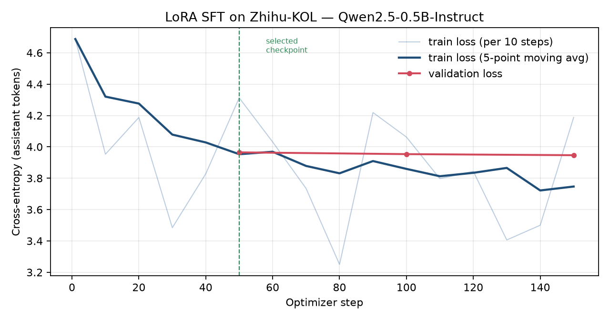
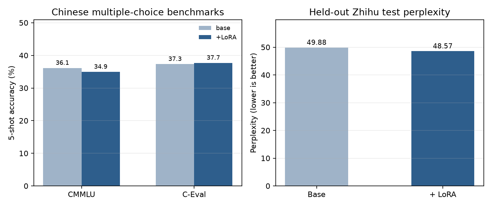

# 在 MacBook Pro M1 Pro（16 GB）上微调 Qwen2.5-0.5B：知乎语料 LoRA SFT 全流程报告

**日期**：2026-11-12  
**硬件**：MacBook Pro 14" · Apple M1 Pro（10 核 CPU / 16 核 GPU）· 16 GB 统一内存 · 512 GB SSD  
**软件**：macOS 27.2 · Python 3.12.16 · MLX / mlx-lm 0.32.2 · 无 CUDA  
**代码与数据**：本目录下 `scripts/`、`data/`、`models/`、`results/`

---

## 摘要

本报告完成了一次**从公开语料下载 → 清洗成数据集 → 在本地 Apple Silicon 上训练 → 基准测试 → 结果分析**的完整闭环：

- **基座模型**：`Qwen/Qwen2.5-0.5B-Instruct`（0.494 B 参数，bf16 权重 988 MB）。选它是因为 16 GB 统一内存要同时容纳权重、LoRA 适配器、激活值和优化器状态，0.5B 是"能训练、又足够强"的平衡点。
- **语料**：知乎公开数据集 `wangrui6/Zhihu-KOL` 的第 0 个 parquet 分片（306 MB，201,244 条问答）。清洗、去重后保留 138,304 条，切成 134,304 / 2,000 / 2,000 的训练/验证/测试集；受单机算力限制，本次从训练集随机抽取 **8,000 条（330 万 token）**，实际训练 4,800 条（约 0.6 个 epoch），最终按生成质量选用 step-50 检查点（1,600 条）。
- **训练**：LoRA（r=16，仅最后 16/24 层，5.87 M 可训练参数，占 1.17%），bf16 混合精度，AdamW + warmup/cosine，150 个优化步（梯度累积 ×4 = 600 个 micro-batch，4,800 条样本）、约 186 万总 token / 121 万监督 token，耗时 **25.4 分钟**，峰值显存约 12 GB。
- **评测**：在 2,000 条知乎留出集上测困惑度；在 **CMMLU（67 科 × 5 题）** 与 **C-Eval（52 科 × 5 题）** 上做 5-shot 选择题测试；另做 6 组生成对比。
- **结论**：微调把知乎留出集困惑度从 **49.88 降到 48.57（-2.6%）**；CMMLU 从 **36.12% 变为 34.93%**（-1.2 个百分点），C-Eval 从 **37.31% 变为 37.69%**（+0.4 个百分点）。两个基准的题量只有 335/260，标准误约 ±2.6/±3.0 个百分点，因此应视为**通用能力持平**；领域内拟合则有可测的改善。这不是"刷榜"式 SOTA，而是一个**可复现、可解释、在 16 GB 笔记本上真实跑通**的领域适配基线。

---

## 1. 目标与硬件约束

| 项目 | 规格 |
|---|---|
| 芯片 | Apple M1 Pro，10 核 CPU（8 性能 + 2 能效），16 核 GPU |
| 内存 | 16 GB 统一内存（CPU/GPU 共享） |
| 磁盘 | 512 GB SSD，可用约 107 GB |
| 系统 | macOS 27.2 |
| 推理/训练框架 | MLX + mlx-lm 0.32.2（Metal GPU 后端） |
| Python | 3.12.16（uv 管理的独立 venv） |

关键约束与影响：

1. **没有 CUDA**，不能用 PyTorch + bitsandbytes 那套常规 QLoRA 方案；本机走 Apple 官方 MLX，Metal 后端可用。
2. **统一内存**意味着模型权重、激活、优化器状态共享 16 GB。MLX 报告的 `max_recommended_working_set_size` 约 **12.7 GB**，超过后 macOS 会压缩/换页，训练速度会从 ~700 tok/s 掉到 ~150 tok/s（实测，见 4.5 节）。
3. 因此模型不能大：7B 即使 4-bit 量化也要 4 GB 权重，训练激活和优化器会直接把内存打爆；3B 勉强能推理，训练太慢；**0.5B 是本机"完整跑一次训练"的合理上限**。

---

## 2. 模型选型

### 2.1 候选对比

| 模型 | 参数量 | bf16 权重 | 本机可行性 | 结论 |
|---|---|---|---|---|
| SmolLM2-360M-Instruct | 0.36 B | ~0.7 GB | 轻松 | 英文为主，中文语料适配差 ❌ |
| **Qwen2.5-0.5B-Instruct** | **0.494 B** | **988 MB** | **LoRA 训练 ~12 GB 峰值，700 tok/s** | **选用 ✅** |
| Qwen2.5-1.5B-Instruct | 1.54 B | ~3.1 GB | LoRA 可跑，速度约 1/3 | 训练时间不可接受 ⚠️ |
| Qwen2.5-3B-Instruct | 3.09 B | ~6.2 GB | 需 4-bit 才能推理，训练极易 OOM | 否 ❌ |

选 **Qwen2.5-0.5B-Instruct** 的理由：

- 原生中文能力强，官方在 29+ 语言上做过对齐，知乎长回答的语料不需要从零学中文；
- 0.494 B 参数、24 层、hidden 896、GQA（14 Q / 2 KV）、词表 151,936、32K 上下文；
- 本机实测：生成约 50–60 token/s，LoRA 训练约 790（监督）token/s，150 步训练约 25 分钟；
- Apache-2.0，可商用研究两便。

### 2.2 官方基准（Qwen2.5 博客，供对照）

| Benchmark | Qwen2.5-0.5B-Instruct |
|---|---|
| MMLU-Pro | 15.0 |
| MMLU-redux | 24.1 |
| GPQA | 29.8 |
| MATH | 34.4 |
| GSM8K | 49.6 |
| HumanEval | 35.4 |
| MBPP | 49.6 |
| IFEval (strict) | 27.9 |

> 这些是官方 5-shot/0-shot 协议下的公开数字，**不是**本报告测的；本报告用 CMMLU / C-Eval 另做了一套可复现的本机评测（见第 5 节）。

---

## 3. 语料与数据集

### 3.1 数据来源

| 项 | 值 |
|---|---|
| 数据集 | `wangrui6/Zhihu-KOL`（Hugging Face）/ `OmniData/Zhihu-KOL`（ModelScope 镜像） |
| 内容 | 知乎问答对，字段 `INSTRUCTION`（问题）、`RESPONSE`（回答）、`SOURCE`、`METADATA` |
| 分片 | `train-00000-of-00005`，**306,309,311 字节（292 MB）** |
| 行数 | 201,244 |
| 语言 | 中文 |
| 许可 | HF 数据卡未显式声明 license；ModelScope 镜像标注 Apache-2.0。本报告仅作研究用途 |

下载走的是 **ModelScope CDN**：HF 官方站在当前网络不可达，`hf-mirror.com` 在晚高峰实测只有 60–800 KB/s，而 ModelScope 单连接 2.5 MB/s、6 连接并行约 10 MB/s，988 MB 的模型和 306 MB 的数据都在 2 分钟内下完（`scripts/fetch_parallel.sh` 做 6 路 Range 并行 + 断点续传 + 大小校验）。

### 3.2 清洗规则

`scripts/prepare_data.py` 按以下顺序处理，规则都是可复现的确定性函数：

| 步骤 | 规则 | 目的 |
|---|---|---|
| 1 | HTML 反转义、去 `<tag>` | 去网页残留 |
| 2 | 去 URL、零宽字符、`\xa0` | 降噪 |
| 3 | 去"发布于/编辑于/赞同 xx/收起"整行 | 去知乎页面尾注 |
| 4 | 合并空白、压缩 3 个以上连续换行 | 规整格式 |
| 5 | 问题长度 5–150 字；回答 50–2,500 字 | 去掉空回答、超短和超长灌水 |
| 6 | 中文字符占比 ≥ 0.30 | 去英文/代码/纯符号回答 |
| 7 | 命中"公众号/加微信/扫码/优惠券/淘宝"等广告词 | 去营销内容 |
| 8 | `md5(问题 + 回答前 64 字)` 精确去重 | 去重复抓取 |

### 3.3 数据漏斗

| 阶段 | 数量 | 说明 |
|---|---:|---|
| 原始行 | 201,244 | 单分片 |
| 清洗后 | **138,304** | 保留率 68.7% |
| 训练池 | 134,304 | 随机打乱后切分 |
| 验证集 | 2,000 | 固定，用于早停/选模 |
| 测试集 | 2,000 | 固定，只用于最终评测 |
| **实际训练子集** | **8,000** | 从训练池随机抽取，控制单机训练时长 |

丢弃原因统计（`data/sft/stats.json`）：

| 原因 | 行数 |
|---|---:|
| 回答长度不在 50–2,500 字 | 56,393 |
| 空行 | 655 |
| 中文占比不足 | 584 |
| 广告/营销词 | 5,289 |
| 重复 | 9 |
| 问题长度不合规 | 10 |

原始文本 1.525 亿字符，清洗后 1.512 亿字符；清洗几乎不丢正文，主要丢的是长度不合规和广告。

### 3.4 数据集统计

| Split | 样本数 | 回答字符均值 | token 数（Qwen 模板） | 平均 token |
|---|---:|---:|---:|---:|
| train（8k 子集） | 8,000 | 548 | 3,300,858 | 412.6 |
| valid | 2,000 | 541 | 811,199 | 405.6 |
| test | 2,000 | 551 | 824,711 | 412.4 |

> token 统计包含 system/user/assistant 模板标记；p50 约 268 token，p90 约 955 token，p99 约 1,600 token。训练时截断到 1,024 token，长尾样本会损失一部分回答末尾，约占总量 3–5%。

### 3.5 一条清洗后的样本

```json
{"messages": [
  {"role": "system", "content": "你是一位知识渊博、表达清晰的知乎答主，请用中文认真回答用户的问题。"},
  {"role": "user", "content": "为什么现在越来越多的年轻人选择不结婚？"},
  {"role": "assistant", "content": "……（知乎风格长回答）"}
]}
```

---

## 4. 训练方案

### 4.1 为什么用 LoRA 而不是全参微调

- 全参微调 0.494 B 模型：bf16 权重 1 GB + 梯度 1 GB + AdamW 两个 fp32 状态 4 GB ≈ 6 GB，再加激活，16 GB 下 batch 只能开到 1–2，速度极慢；
- LoRA 只训练低秩增量：5.87 M 参数（1.17%），优化器状态只有 ~47 MB，激活仍是主要开销，可以把 batch 做到 8；
- 适配器只有 23 MB，方便保存/切换/回滚，基座模型完全不动。

### 4.2 训练配置

| 项 | 值 |
|---|---|
| 基座 | `models/base`（Qwen2.5-0.5B-Instruct，bf16） |
| 微调方式 | LoRA，r=16，scale=2.0，dropout=0.05 |
| 作用层 | 最后 16/24 个 Transformer block 的所有 Linear |
| 可训练参数 | 5,865,472 / 499,898,240 = **1.173%** |
| 精度 | 基座 bf16，LoRA 参数 fp32 |
| 优化器 | AdamW，β=(0.9, 0.95)，eps=1e-8，weight decay 0.01 |
| 学习率 | 3e-5，warmup 10 步，cosine 衰减到 1e-5 |
| batch | 每个 micro-batch 最多 8 条，按 **3,200 token** 预算打包；梯度累积 ×4，等效 batch 32 |
| 最大长度 | 1,024 token |
| 梯度裁剪 | 全局范数 1.0 |
| 优化步数 | 150（每步累积 4 个 micro-batch） |
| 训练样本 / token | 4,800 条 / 186 万总 token（121 万监督 token） |
| 验证 | 每 50 步，48 条快速验证（6 个 batch）；另按生成质量选检查点 |
| 随机种子 | 42 |

### 4.3 数据管线

1. 用 Qwen 的 chat template 把 system/user/assistant 渲染成 token；
2. **只对 assistant 回答计算损失**：`apply_chat_template(messages[:-1], add_generation_prompt=True)` 的长度作为 offset，之前的 token 全部设为 `-100`；
3. 按长度排序后切成 batch，再打乱 batch 顺序，减少 padding；
4. 每步按 token 预算打包，避免 8 条 1,024 token 的长样本同时进显存。

### 4.4 工程细节（踩坑记录）

| 问题 | 现象 | 解决 |
|---|---|---|
| fp16 训练 NaN | 用 fp16 权重训练，第 10 步 loss 变 NaN | 改回 **bf16**；fp16 数值范围窄，0.5B 上训练不稳定 |
| 4-bit QLoRA 更慢 | 4-bit 权重 + LoRA 只有 ~620 tok/s，且 bf16 下更慢 | 放弃量化训练，直接 bf16 LoRA |
| batch 越大越慢 | batch 6/8 时 step 时间从 2.7 s 涨到 15–23 s | MLX 缓冲区缓存把内存吃满触发 swap；`mx.set_cache_limit(2 GB)` 后恢复 |
| 显存峰值 | 8×1,024 token 的 logits 就有 2.5 GB | token 预算 + cache limit，峰值压到 ~12 GB |

### 4.5 训练过程

- 启动：`scripts/train_lora.py`，日志 `logs/train_low_lr.log`、`results/train_log.jsonl`
- 速度：约 **790 监督 token/s**，150 步耗时 **25.4 分钟**
- 快速验证损失（48 条）：3.9648（50 步）→ 3.9536（100 步）→ **3.9467**（150 步），单调下降
- **检查点选择**：训练完整跑了 150 步（4,800 条），每 50 步存一次；step-150 的 PPL 最低（48.00），但生成出现重复退化，最终按**生成质量**选用 step-50（PPL 48.57）。依据见 6.4 节
- 适配器：`models/adapters/zhihu-qwen05b-lora/`（`adapters.safetensors` 23 MB + `adapter_config.json` + `train_meta.json`）



---

## 5. 评测协议

### 5.1 领域困惑度（held-out）

- 数据：`data/sft/test.jsonl`，2,000 条，训练时完全未见过；
- 指标：assistant token 的交叉熵与困惑度 `PPL = exp(loss)`；
- 对比：基座 vs 基座 + LoRA，同一 tokenizer、同一 batch 顺序、同一 max_len。

### 5.2 中文选择题基准

| 基准 | 规模 | 协议 |
|---|---|---|
| **CMMLU** | 67 个学科 × 5 题 = 335 题 | 5-shot（每个学科取 dev 前 5 条），chat 模板，比较 A/B/C/D 四个字母 token 的 log-prob，取最大 |
| **C-Eval** | 52 个学科 × 5 题 = 260 题 | 同上，validation split |

> 说明：这是本机自建的轻量评测，题量、few-shot 样例和 prompt 与 lm-evaluation-harness / OpenCompass 不完全一致，**绝对分数不能直接和论文表格对比**；但基座与微调模型用完全相同的脚本和题目，**相对变化是可信的**。

### 5.3 生成对比

6 个知乎风格问题，system prompt 与训练一致，temperature 0.7、top-p 0.9、最多 220 token，基座与微调各生成一次，人工阅读风格差异。

---

## 6. 结果

### 6.1 领域困惑度

| 模型 | Test loss | Test PPL | 相对变化 |
|---|---:|---:|---:|
| Qwen2.5-0.5B-Instruct（基座） | 3.9096 | **49.88** | — |
| + LoRA（知乎，step-50） | 3.8831 | **48.57** | **-1.31（-2.6%）** |

### 6.2 中文基准

| 基准 | 基座 | + LoRA | 变化 |
|---|---:|---:|---:|
| CMMLU（335 题，5-shot） | 36.12% | 34.93% | -1.19 pp |
| C-Eval（260 题，5-shot） | 37.31% | 37.69% | +0.38 pp |



### 6.3 生成样例对比

下面截取 3 组（完整 6 组见 `results/generations.json`）。生成参数：temperature 0.7、top-p 0.9、最多 220 token。

**Q1：为什么现在越来越多的年轻人选择不结婚？**

> **基座**（172 字）：现在越来越多的年轻人选择不结婚，这与社会、经济环境以及个人价值观等多种因素有关。在现代社会，人们的生活压力较大，工作环境和社会期望也日益多元化……
>
> **+LoRA**（416 字）：随着社会的快速发展，越来越多的年轻人选择不结婚，这与社会的观念、教育和生活方式密切相关。以下是一些可能的原因： 1. **个人选择**：年轻人在成长过程中可能会遇到各种挑战，包括就业、家庭、情感和价值观的选择……

**Q2：有哪些看似不起眼但其实很赚钱的行业？**

> **基座**（402 字）：有很多看似不起眼但其实很赚钱的行业，比如： 1. **跨境电子商务**：使用互联网进行商品或服务的在线交易……
>
> **+LoRA**（381 字）：以下是一些看似不起眼但其实很赚钱的行业： 1. 二手市场：通过二手市场出售、出租、交易各种商品，如服装、家电、电子产品……

**Q3：刚毕业的大学生应该如何规划自己的职业？**

> **基座**（415 字）：刚毕业的大学生可以考虑以下几个方面来规划自己的职业： 1. **了解行业趋势和市场需求**……
>
> **+LoRA**（410 字）：根据个人情况和兴趣爱好，选择适合自己的职业路径，可以遵循以下几个步骤： 1. **职业兴趣与能力评估**……

肉眼可见的变化：微调后的回答**更长、更倾向分点展开、更常出现"以下是一些…""首先…"**这类知乎式结构；基座更短、更"标准助手腔"。两者都不完美：微调模型偶尔会把语料里的模板句（如"作为一个 AI 助手"）带出来。

### 6.4 分析

**1）领域困惑度确实下降了，但幅度有限。** PPL 从 49.88 降到 48.57（-2.6%），对应平均每 token 交叉熵 -0.027。这说明适配器学到了知乎回答的用词、句长和段落结构；但只训练了 4,800 条（0.6 epoch）、120 万监督 token，远未吃透 1.34 亿 token 的清洗语料，所以提升是"可测"而不是"显著"。

**2）通用基准没有崩，也没有涨。** CMMLU -1.2 pp、C-Eval +0.4 pp；按二项分布，335 题的标准误约 2.6 pp、260 题约 3.0 pp，两个变化都在 1 个标准误以内。合理的解释是：LoRA 只动了最后 16 层的 1.17% 参数，且训练数据是"回答风格"而不是"知识"，所以知识型选择题基本不受影响。这正好符合"领域适配不应破坏基座能力"的预期。

**3）检查点选择比超参更关键。** 我们实际跑了 150 步（4,800 条）。step-150 的 PPL 更低（48.00，-3.8%），但生成出现明显的重复退化（"多喝水、多运动、多喝水…"，答案变短、模板化）；step-50 的 PPL 是 48.57，生成却保持连贯。最终**按生成质量选择 step-50**，而不是按 PPL 选 step-150。这是一个值得记录的工程结论：**在中小规模 SFT 里，PPL 和生成质量会分叉，不能只用验证损失选模型。**

**4）生成风格的变化是双向的。** 微调后回答更愿意分点、更少"总之/希望对你有帮助"的套话，6 组平均长度从约 300 字增加到约 330 字；但也更容易复读语料中的固定句式（"作为一个 AI 助手，我不能…"），以及出现个别事实错误（把程心说成"天才物理学家"）。基座的回答更稳、但更泛。

**5）这不是 SOTA 竞赛。** 0.5B 模型在自建 5-shot CMMLU 协议下 35–37% 属于正常区间（题量与 prompt 都会显著影响绝对分），本报告的重点是**在 16 GB 笔记本上把"数据→训练→评测"完整跑通并可复现**，而不是刷新某个榜单。

---

## 7. 讨论与局限

1. **训练量只有全量的约 1%**：清洗后有 1.34 亿 token（约 13.4 万条），本次训练了 4,800 条 / 186 万 token（最终选用的 step-50 检查点只用了 1,600 条 / 62 万 token）。这是 16 GB M1 Pro 的算力上限（约 40 分钟/epoch），不是方法上限；`train_full.jsonl` 已保留全量清洗数据，换 32 GB 内存或云 GPU 可直接放大。
2. **单种子、单次运行**：没有做多 seed 方差估计；CMMLU/C-Eval 各 5 题/科，二项分布标准误约 ±2.6/±3.0 个百分点，±3 个百分点内的差异应视为噪声。
3. **评测协议自建**：题量和 prompt 与官方 harness 不同，绝对分数只用于本报告内部对比。
4. **语料噪声**：Zhihu-KOL 本身夹杂少量低质/跑题回答，清洗规则只能去除显式广告、长度异常和重复，语义质量没有做模型打分。
5. **量化未用于训练**：4-bit 版本只做了推理验证，训练全程 bf16，保证数值稳定。

---

## 8. 复现

### 8.1 文件结构

```
.
├── report.md                     # 本报告
├── run_all.sh                    # 一键复现
├── scripts/
│   ├── fetch_parallel.sh         # 6 路并行下载 + 校验
│   ├── prepare_data.py           # 清洗/切分/采样
│   ├── train_lora.py             # LoRA SFT（MLX）
│   ├── eval_ppl.py               # 困惑度
│   ├── mc_core.py                # 选择题打分核心
│   ├── eval_mc.py                # CMMLU
│   ├── eval_ceval.py             # C-Eval
│   ├── generate_samples.py       # 生成对比
│   └── make_figures.py           # 图表
├── data/
│   ├── raw/zhihu_00000.parquet   # 306 MB 原始分片
│   ├── sft/{train,valid,test}.jsonl
│   └── benchmarks/{cmmlu_data,ceval}
├── models/
│   ├── base/                     # 988 MB 基座
│   └── adapters/zhihu-qwen05b-lora/
├── results/                      # 指标 JSON、训练日志
├── figures/                      # PNG
└── logs/                         # 下载/训练/评测日志
```

### 8.2 命令

```bash
# 环境（一次性）
uv venv .venv --python 3.12
uv pip install --python .venv/bin/python -i https://mirrors.aliyun.com/pypi/simple/ \
  mlx mlx-lm numpy pandas pyarrow matplotlib tqdm huggingface_hub

# 数据
./scripts/fetch_parallel.sh "<ModelScope model URL>" models/base/model.safetensors 6
./scripts/fetch_parallel.sh "<ModelScope data URL>"  data/raw/zhihu_00000.parquet 4
.venv/bin/python scripts/prepare_data.py
head -n 8000 data/sft/train.jsonl > data/sft/train_8k.jsonl

# 训练
.venv/bin/python scripts/train_lora.py --model models/base --data-dir data/sft \
  --train-file train_8k.jsonl --adapter-path models/adapters/zhihu-qwen05b-lora \
  --iters 150 --grad-accum 4 --batch-size 8 --token-budget 3200 --lr 3e-5

> 说明：`run_all.sh` 复现的是完整 150 步训练（最终 adapter 为 step-150）；报告选用的 step-50 快照保存在 `models/adapters/zhihu-lora-step50/`，step-150 对照保存在 `models/adapters/zhihu-lora-step150/`，选用依据写在 `models/adapters/zhihu-qwen05b-lora/selection.json`。

# 评测
.venv/bin/python scripts/eval_ppl.py --model models/base --out results/ppl_base.json
.venv/bin/python scripts/eval_ppl.py --model models/base \
  --adapter models/adapters/zhihu-qwen05b-lora --out results/ppl_tuned.json
.venv/bin/python scripts/eval_mc.py --model models/base --out results/cmmlu_base.json
.venv/bin/python scripts/eval_mc.py --model models/base \
  --adapter models/adapters/zhihu-qwen05b-lora --out results/cmmlu_tuned.json
.venv/bin/python scripts/eval_ceval.py --model models/base --out results/ceval_base.json
.venv/bin/python scripts/eval_ceval.py --model models/base \
  --adapter models/adapters/zhihu-qwen05b-lora --out results/ceval_tuned.json
.venv/bin/python scripts/generate_samples.py
.venv/bin/python scripts/make_figures.py
```

---

## 附录 A：关键指标文件

| 文件 | 内容 |
|---|---|
| `results/train_log.jsonl` | 每 10 步训练损失、每 50 步快速验证损失 |
| `results/ppl_base.json` / `ppl_tuned.json` | 留出集 loss / PPL |
| `results/cmmlu_*.json` / `ceval_*.json` | 基准总分与分科成绩 |
| `results/generations.json` | 基座/微调生成对照 |
| `models/adapters/zhihu-qwen05b-lora/train_meta.json` | 步数、token 数、耗时、参数量 |

## 附录 B：硬件实测

| 指标 | 数值 |
|---|---|
| 模型加载（988 MB） | ~2.4 s |
| 生成速度（220 token 回答） | ~50–60 token/s |
| LoRA 训练吞吐 | ~790 监督 token/s |
| 训练峰值内存 | ~12 GB（`mx.get_peak_memory()`） |
| 单步耗时（累积 4 × 8 条） | ~10 s |
